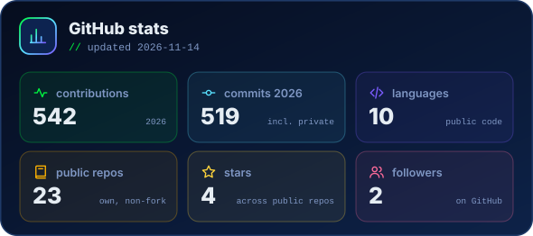
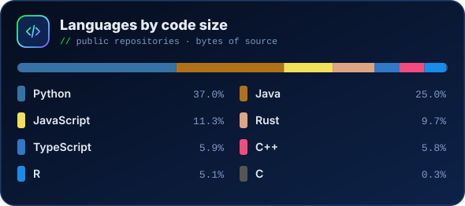
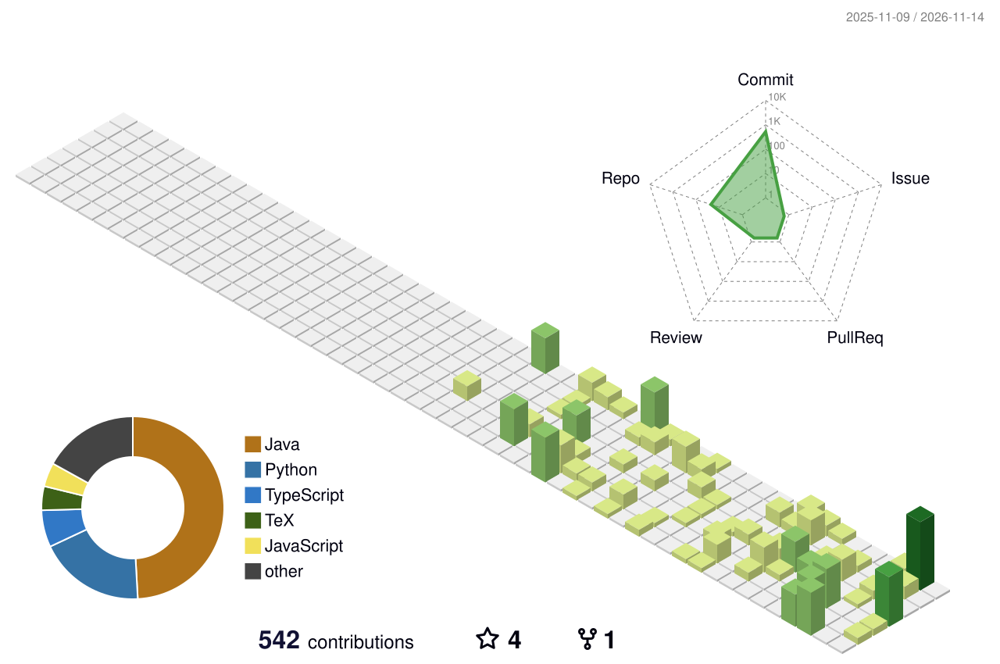

<!-- Profile README · R. Andre Vilca-Solorzano
     Images in assets/ are original SVGs made for this profile; technology logos come from Simple Icons (CC0).
     Live cards (stats, languages, snake, 3D calendar) are rebuilt daily by .github/workflows/profile.yml
     and published to the `output` branch. -->

  

  
  
  
  
  

  

 

I work at the meeting point of **research** and **full-stack software development**, at
**[Universidad Nacional del Altiplano (FINESI)](https://www.unap.edu.pe/)** in Puno, Peru — 3,827 m above sea level.

- **Research & development** — machine learning on `Sentinel-2`, `Landsat` and `NASA` data for frost, glacial-lake floods (GLOFs), water quality and astrophysics, always with open, reproducible code
- **Full-stack software** — I design, build and self-host institutional systems end to end: backend, frontend, database and server
- **Core languages** — `Rust` · `Java` · `C++` · `Node.js` · `TypeScript`; backends in Spring Boot, Jakarta EE, .NET, Express, Django and Laravel
- **Cross-platform apps** — desktop and device tools that run on `macOS`, `Linux` and `Windows`
- **Open-source frameworks** — [JxMVC](https://github.com/Andre031222/jxmvc) and [Cero](https://github.com/Andre031222/Cero), Java web frameworks with zero runtime dependencies
- **Publications** — 6 published and 3 accepted — J. Astrophysics &amp; Astronomy, SoftwareX, World J. Environmental Biosciences, IJACSA, Informatica and Springer proceedings; 7 more submitted or under review, three of them to Scopus Q1 journals
- **Production** — 10+ apps running on my own Linux VPS · [andre.net.pe](https://andre.net.pe)
- **Setup** — `Arch Linux` (Hyprland + Kitty), `macOS` and `Windows`
- Always with the **CR7 mentality** — *"work beats talent"*

 

 

  
  
  
  
  
  
  

| N° | Year | Work | Venue | Status | Code |
|---|------|------|-------|--------|------|
| 1 | 2026 | **Physics-Informed Ensemble Learning for Exoplanet Transit Detection** — BLS + Attention CNN + XGBoost (ROC-AUC 0.9948) | *Journal of Astrophysics and Astronomy* 47, 53 (Springer) · [Scimago Verified: Scopus Q2](https://www.scimagojr.com/journalsearch.php?q=27688&tip=sid&clean=0) |  | [GitHub](https://github.com/Andre031222/ExoplanetHybridPipeline) |
| 2 | 2026 | **Multiple Linear Regression Outperforms Machine Learning for Monthly Temperature Forecasting across the Peruvian Altiplano** — verified against climatology, replicated across 11 series (Puno, Peru) | *World Journal of Environmental Biosciences* 15(3) · [Scimago Verified: Scopus Q2](https://www.scimagojr.com/journalsearch.php?q=21101272728&tip=sid&clean=0) |  | [GitHub](https://github.com/Andre031222/monthly-temperature-forecasting-altiplano) |
| 3 | 2026 | **AgroYachay** — open-source IoT + LLM platform supporting agronomic and economic decision-making for Andean smallholders | *SoftwareX* · [Scimago Verified: Scopus Q2](https://www.scimagojr.com/journalsearch.php?q=21100422153&tip=sid&clean=0) |  | [GitHub](https://github.com/Andre031222/agroyachay) |
| 4 | 2026 | **CITAE — A Passage-Verifiable Retrieval-Augmented Generation Platform** for the scientific-literature workflow | *Informatica* 50(15) · [DOI](https://doi.org/10.31449/inf.v50i15.15471) |  | [GitHub](https://github.com/Andre031222/Citae-Ginit) |
| 5 | 2026 | **ML-Based Runtime Prediction &amp; Energy Optimization for HPC Job Scheduling** — NREL Eagle, 7.3M jobs *(co-author)* | *Informatica* 50(15) · [DOI](https://doi.org/10.31449/inf.v50i15.15344) |  | [GitHub](https://github.com/rntvargas/hpc-runtime-prediction) |
| 6 | 2025 | **Comparative Analysis of Statistical, ML &amp; DL for Frost Prediction in the Peruvian Altiplano** | *IJACSA* 16(9) · [Scimago Verified: Scopus Q3](https://www.scimagojr.com/journalsearch.php?q=21100867241&tip=sid&clean=0) |  | [GitHub](https://github.com/Andre031222/frost-prediction-altiplano-puno) |
| 7 | 2026 | **When Machine Learning Beats Persistence: A Leakage-Free Streamflow and Drought Benchmark for the Tropical Andes** — 19 Andean gauges, 1/3/7-day leads, drought-day detection (Peru/Chile) | *ICICCDS 2027* proceedings paper · Springer *Studies in Autonomic, Data-Driven and Industrial Computing* (Scopus) · [Conference](https://www.iciccds.com/) |  | [GitHub](https://github.com/Andre031222/streamflow-drought-altiplano) |
| 8 | 2026 | **Ritmo: A Privacy-Preserving Smartphone App and Live Dashboard for Passive Behavioral Sensing on Mid-Range Android Devices** — Android app + laptop receiver, no third-party servers *(co-author)* | *ICICCDS 2027* proceedings paper · Springer *Studies in Autonomic, Data-Driven and Industrial Computing* (Scopus) · [Conference](https://www.iciccds.com/) |  | [GitHub](https://github.com/Maribel-y/ritmo) |
| 9 | 2026 | **Survey-Weighted Longitudinal Analysis of Preschool Shared Reading and Adolescent Vocabulary in Chile** — ELPI cohort, 5,016 participants, 12-year follow-up *(co-author)* | *ICICCDS 2027* proceedings paper · Springer *Studies in Autonomic, Data-Driven and Industrial Computing* (Scopus) · [Conference](https://www.iciccds.com/) |  | [GitHub](https://github.com/rntvargas/Survey-Weighted-Longitudinal-Analysis-of-Preschool-Shared-Reading-and-Adolescent-Vocabulary-in-Chile) |
| 10 | 2026 | **A Plug-and-Play Desktop Tool for End-to-End Manufacturing and Commissioning of ESP32-Based Agricultural IoT Sensor Nodes** (AgroCommish) | *SoftwareX* · [Scimago Verified: Scopus Q2](https://www.scimagojr.com/journalsearch.php?q=21100422153&tip=sid&clean=0) |  | [GitHub](https://github.com/Andre031222/agrocommish) |
| 11 | 2026 | **Near-Duplicate Leakage and Auto-Label Reliability in Image Datasets Assembled From Public Sources: An Audited Benchmark for Alpaca Detection** — 82% of a random test split had a training copy; size-matched and split-variance controls; open CC BY 4.0 benchmark of 517 photographs (Peru) | *IEEE Access* |  | [GitHub](https://github.com/Andre031222/data-integrity-vision-language-auto-labelling) |
| 12 | 2026 | **JxMVC: a secure-by-default web framework without third-party dependencies** — 17 of 18 default protections vs 8–9 in Spring Boot, Quarkus, Micronaut and Javalin; 120.9 M requests without errors | *Software Quality Journal* (Springer) |  | [GitHub](https://github.com/Andre031222/jxmvc) |
| 13 | 2026 | **Harmonized Landsat–Sentinel-2 Separability over Lakes and Campaign-Level Validation of Satellite Secchi Depth in Lake Titicaca** — NASA HLS sensors stay separable over water in 27 lakes; campaign-blocked validation (Peru/Bolivia) | *Physics and Chemistry of the Earth* (Elsevier) |  | [GitHub](https://github.com/Andre031222/harmonized-titicaca-transparency) |
| 14 | 2026 | **Machine Learning Prediction of Live Weight from Zoometric Measurements in Ch'acu and K'ara Llamas** — nested cross-validation of 11 models and field equations (240 llamas, Puno, Peru) | *Smart Agricultural Technology* (Elsevier) · [Scimago Verified: Scopus Q1](https://www.scimagojr.com/journalsearch.php?q=21101111783&tip=sid&clean=0) |  | [GitHub](https://github.com/Andre031222/ml-live-weight-zoometric-chacu-kara-llamas) |
| 15 | 2026 | **Random Cross-Validation Overestimates the Accuracy of Machine-Learning Environmental Maps: A Meta-Analysis of 266 Studies** — PRISMA 2020 systematic review and three-level meta-analysis of 1,102 effect sizes; random CV inflates R² by 0.21, most for clustered samples | *International Journal of Geographical Information Science* (Taylor &amp; Francis) · [Scimago Verified: Scopus Q1](https://www.scimagojr.com/journalsearch.php?q=28040&tip=sid&clean=0) |  | [GitHub](https://github.com/Andre031222/spatial-cv-meta-analysis) |
| 16 | 2026 | **Manuscript under double-blind peer review** — palaeontology / spatial modelling; title, authors and code withheld until the editorial decision | *Palaeontologia Electronica* · [Scimago Verified: Scopus Q1](https://www.scimagojr.com/journalsearch.php?q=14002&tip=sid&clean=0) (Paleontology, SJR 2025 0.646) |  | — |
| 17 | 2026 | **How Far Does a Glacial Lake Outburst Flood Susceptibility Model Travel? Transfer Tests Across the Andes** — 41-year Landsat/Sentinel-2 lake inventory, spatial and temporal transfer tests (South America) | *Natural Hazards* (Springer) · Q1 |  | [GitHub](https://github.com/Andre031222/glof-susceptibility-transfer-andes) |

 

| Repository | Description |
|------------|-------------|
| **[monthly-temperature-forecasting-altiplano](https://github.com/Andre031222/monthly-temperature-forecasting-altiplano)** | When multiple linear regression beats ML for monthly temperature forecasting (Altiplano, Peru) ·  |
| **[ExoplanetHybridPipeline](https://github.com/Andre031222/ExoplanetHybridPipeline)** | Physics-informed ensemble for exoplanet transit detection (BLS + Attention CNN + XGBoost) ·  |
| **[frost-prediction-altiplano-puno](https://github.com/Andre031222/frost-prediction-altiplano-puno)** | Benchmark of 12 forecasting models for frost / min-temperature prediction (Puno, Peru) ·  |
| **[Citae-Ginit](https://github.com/Andre031222/Citae-Ginit)** | Passage-verifiable RAG platform for the scientific-literature workflow ·  |
| **[hpc-runtime-prediction](https://github.com/rntvargas/hpc-runtime-prediction)** | ML runtime prediction &amp; energy optimization for HPC job scheduling on NREL Eagle *(co-author)* ·  |
| **[agroyachay](https://github.com/Andre031222/agroyachay)** | Open-source IoT + LLM platform for climate-smart decision support in Andean agriculture (Andes) ·  |
| **[agrocommish](https://github.com/Andre031222/agrocommish)** | Plug-and-play desktop wizard to flash, configure and test ESP32 agricultural sensor nodes in batches; companion of AgroYachay (v1.2.1, [Zenodo](https://doi.org/10.5281/zenodo.24139256)) ·  |
| **[streamflow-drought-altiplano](https://github.com/Andre031222/streamflow-drought-altiplano)** | Leakage-free streamflow &amp; drought forecasting benchmark for 19 Andean gauges — ICICCDS 2027 proceedings paper (Springer) ·  |
| **[data-integrity-vision-language-auto-labelling](https://github.com/Andre031222/data-integrity-vision-language-auto-labelling)** | Near-duplicate leakage audit and open alpaca detection benchmark (v3.1, [Zenodo](https://doi.org/10.5281/zenodo.23579349)) ·  |
| **[harmonized-titicaca-transparency](https://github.com/Andre031222/harmonized-titicaca-transparency)** | Landsat–Sentinel-2 (NASA HLS) separability over 27 lakes and campaign-level validation of Secchi depth in Lake Titicaca (Peru/Bolivia) ·  |
| **[jxmvc](https://github.com/Andre031222/jxmvc)** | Secure-by-default MVC framework for Jakarta EE in a single JAR with zero third-party dependencies — routing, data access, JSON, OpenID Connect, PDF reading &amp; generation · [jxmvc.ginit.dev](https://jxmvc.ginit.dev) ·  |
| **[ml-live-weight-zoometric-chacu-kara-llamas](https://github.com/Andre031222/ml-live-weight-zoometric-chacu-kara-llamas)** | Nested cross-validation of 11 ML &amp; statistical models to predict llama live weight from body measurements (Puno, Peru) ·  |
| **[spatial-cv-meta-analysis](https://github.com/Andre031222/spatial-cv-meta-analysis)** | Systematic review &amp; multilevel meta-analysis of 266 studies comparing random and spatial cross-validation in ML environmental mapping (data, code &amp; figures; [OSF](https://doi.org/10.17605/OSF.IO/S8Y5H)) ·  |
| **[glof-susceptibility-transfer-andes](https://github.com/Andre031222/glof-susceptibility-transfer-andes)** | Annual glacial lake inventory (1985-2025) and transfer tests of GLOF susceptibility models across cordilleras and years (Andes, South America) ·  |

 

🔒 Private repositories — real institutional systems I design, build &amp; self-host. Details below since the code isn't public.

| System | What it does | Stack |
|--------|--------------|-------|
| **Rantiya** | Point of sale, inventory &amp; SUNAT electronic invoicing for Peruvian businesses | Rust |
| **Reprovisión V7** · UNALM | Dairy-herd management: monthly report loading, pandas engine with cell-by-cell parity against R, role dashboards &amp; PDF reports | Django · DRF · Celery · Next.js 16 · React 19 |
| **Centro de Idiomas** · UNAJ | Language-centre platform: RENIEC enrolment, payments, virtual classroom, grades &amp; QR-verifiable certificates | Cero (Java 25) · React 19 · PostgreSQL 17 |
| **Sherpa** · FINESI | Research management: verifiable CTI Vitae/RENACYT profiles, collaborative LaTeX editor &amp; academic reports | Java |
| **Colmena** | Real-time shared folders for teams of people and AI agents | Svelte |
| **Portal FINESI** · UNA Puno | Institutional portal of the Faculty of Statistics &amp; Computer Engineering | LuxCore · Next.js |
| **CITAE** | All-in-one academic platform to discover, read, verify, cite &amp; share scientific literature, AI-powered | React · Express · PostgreSQL (monorepo) |
| **ZAMASU** · SUNEDU API | Verification of official degrees &amp; titles from Peru's SUNEDU registry — REST API + SSE, institutional portal &amp; Chrome extension | Express · SSE · Next.js 16 · PostgreSQL |
| **DIRESC** | Academic transparency &amp; management for the School Directorate, FINESI — UNA Puno | Spring Boot 3 · Next.js 16 · PostgreSQL |
| **SIEP-UNAJ** | Postgraduate admission-interview system, Univ. Nacional de Juliaca | Spring Boot 3 · Svelte 4 · PostgreSQL |
| **Colegio de Estadísticos** · Puno | Web system for Peru's Statisticians Board (Puno regional council) | React · TypeScript · C++ (LxFramework) · PostgreSQL |
| **Citas Médicas** · UNA Puno | University medical-appointment booking &amp; management | React · Express · PostgreSQL |
| **BioGest** | Biometric university attendance management | C# · .NET 10 · Avalonia · PostgreSQL |
| **Stockia** | Inventory management — products, movements, alerts &amp; reports | Laravel 12 · Filament 4 · PostgreSQL |

Plus <b>Seguimiento de Egresados</b> (alumni tracking, live at egresados.finesi.pe) &amp; other internal tools — 10+ apps self-hosted on my Linux VPS · <a href="https://andre.net.pe">andre.net.pe</a>

 

  

 

  
  

  <picture>
    <source media="(prefers-color-scheme: dark)" srcset="https://raw.githubusercontent.com/Andre031222/Andre031222/output/profile-night-green.svg">
    
  </picture>

  <picture>
    <source media="(prefers-color-scheme: dark)" srcset="https://raw.githubusercontent.com/Andre031222/Andre031222/output/snake-dark.svg">
    
  </picture>

 

  
   
  

